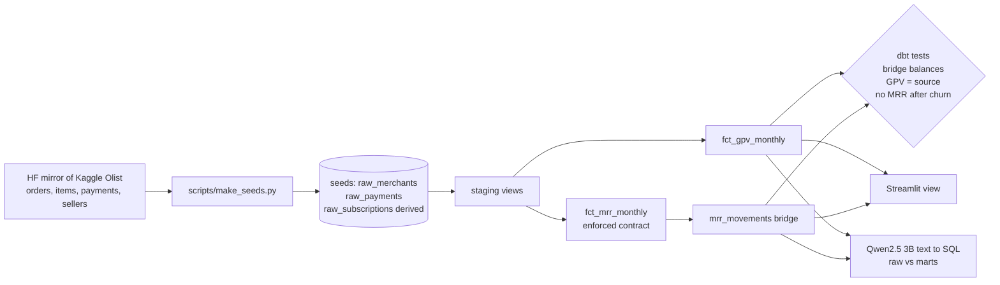
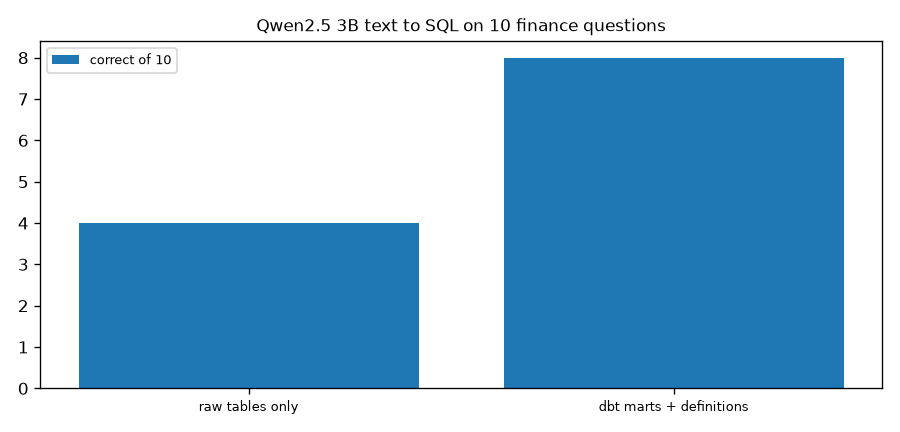
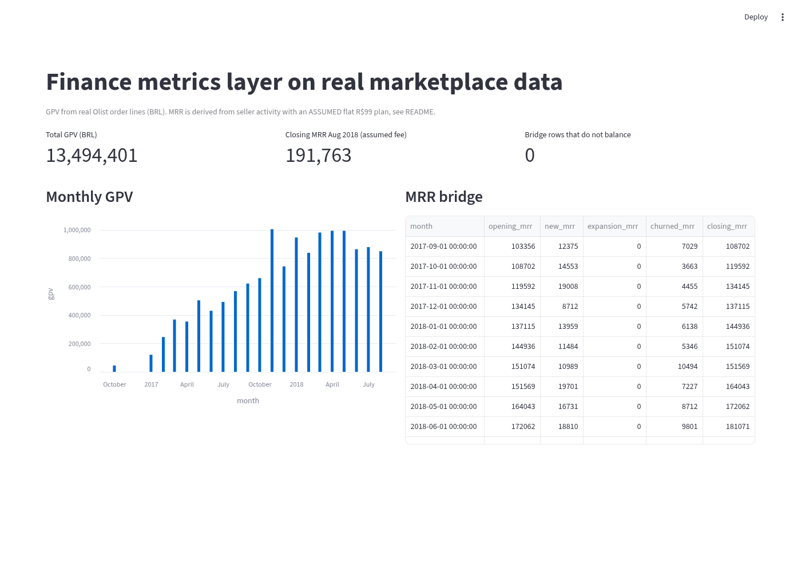

# Finance metrics layer with dbt (real marketplace data)

Define GPV and MRR once, prove they reconcile with tests, and check whether the definitions help an AI tool answer finance questions.

## Data (real, with sources)
- **Olist Brazilian E-Commerce Public Dataset** (Olist, Kaggle `olistbr/brazilian-ecommerce`, **CC BY-NC-SA 4.0**, non commercial). Raw CSVs read from the mirror https://huggingface.co/datasets/bulutttt/olist-raw-data.
- Merchants = 3,053 real marketplace sellers (state as region). Payments = 112,101 real order lines (price in BRL) from Sep 2016 to Aug 2018, cancelled and unavailable orders removed. `scripts/make_seeds.py` builds the seeds.
- **Assumption:** Olist sellers pay a monthly plan, but the fee is not in the data. Subscriptions are derived: start = first sale month, churn = 90 days after the last sale if the seller stopped before 2018-06-01, MRR = flat R$99. So **GPV is real, MRR numbers are illustrative**. Expansion is always 0.
- **Why a substitute:** Lightspeed merchant data is private. Olist is the largest public multi merchant commerce dataset. The old generator is kept as `scripts/make_seeds_synthetic.py`.

## Architecture

More detail in [docs/architecture.md](docs/architecture.md).

## Design tradeoffs
| Decision | Why | Tradeoff |
|---|---|---|
| Derive subscriptions from seller activity | No public subscription data with merchants and payments together | MRR is illustrative, not real revenue |
| Keep tests that reconcile, not just not null | Finance trusts numbers that tie out | Tests only check internal consistency |
| DuckDB locally | Runs in seconds with no cloud account | Same SQL should run on BigQuery, not tested here |
| Test an LLM on the marts | Shows whether the definitions help AI tools | Only 10 questions |

## Results
`dbt build --profiles-dir .`: PASS 24, ERROR 0 (3 seeds, 6 models, 15 tests), about 12 s on the box.

| Item | Value |
|---|---|
| Sellers (merchants) | 3,053 |
| Order lines (payments) | 112,101 |
| Total GPV in mart = source (BRL) | 13,494,400.74 |
| Merchant months in fct_mrr_monthly | 25,041 |
| Dec 2017 bridge (assumed fee) | opening 134,145, new 8,712, churned 5,742, closing 137,115 |
| Aug 2018 bridge (assumed fee) | opening 191,070, new 14,949, churned 14,256, closing 191,763 |
| 2018 churned MRR (assumed fee) | 70,389 |

(v1 of the marts prompt described the column as "month first day date"; the model invented a column `month_first_date` and scored 4 of 10. Fixed wording below, v1 output kept in `docs/llm_sql_results_v1.json`.)

**Does the metrics layer help an AI tool?** Qwen2.5 3B wrote one SQL query for each of 10 finance questions (`python -m lsq.ask`). Correct = within 0.5% of the gold answer.

| Context given to the model | Correct |
|---|---|
| Raw tables only | 4 of 10 |
| dbt marts with Finance definitions | 8 of 10 |



## Error analysis
- Questions the model still got wrong with the marts: GPV in BRL in November 2017?; Average GPV per payment in BRL in 2017?.
- See `docs/llm_sql_results.json` for every generated query.
- The derived churn rule means sellers who paused for 3 months count as churned; real billing data would change these numbers.

## Limitations
- Non commercial licence.
- MRR is based on an assumed flat fee.
- No currency conversion, refunds or plan changes.
- Only 10 LLM questions, written by me.

## UI


## How to run
```bash
pip install dbt-duckdb duckdb streamlit matplotlib
python scripts/make_seeds.py /path/to/olist_csvs   # seeds are already committed
dbt build --profiles-dir .
python -m lsq.ask                  # replays data/llm_cache.json
LLM=ollama python -m lsq.ask       # live
streamlit run app/streamlit_app.py
```
