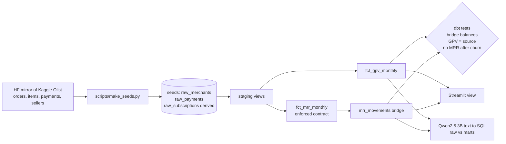

# Architecture

## Data sources

- **Olist Brazilian E-Commerce Public Dataset** (Olist, Kaggle `olistbr/brazilian-ecommerce`, **CC BY-NC-SA 4.0**, non commercial). Raw CSVs read from the mirror https://huggingface.co/datasets/bulutttt/olist-raw-data.
- Merchants = 3,053 real marketplace sellers (state as region). Payments = 112,101 real order lines (price in BRL) from Sep 2016 to Aug 2018, cancelled and unavailable orders removed. `scripts/make_seeds.py` builds the seeds.
- **Assumption:** Olist sellers pay a monthly plan, but the fee is not in the data. Subscriptions are derived: start = first sale month, churn = 90 days after the last sale if the seller stopped before 2018-06-01, MRR = flat R$99. So **GPV is real, MRR numbers are illustrative**. Expansion is always 0.
- **Why a substitute:** Lightspeed merchant data is private. Olist is the largest public multi merchant commerce dataset. The old generator is kept as `scripts/make_seeds_synthetic.py`.

## Design tradeoffs

| Decision | Why | Tradeoff |
|---|---|---|
| Derive subscriptions from seller activity | No public subscription data with merchants and payments together | MRR is illustrative, not real revenue |
| Keep tests that reconcile, not just not null | Finance trusts numbers that tie out | Tests only check internal consistency |
| DuckDB locally | Runs in seconds with no cloud account | Same SQL should run on BigQuery, not tested here |
| Test an LLM on the marts | Shows whether the definitions help AI tools | Only 10 questions |

## Limitations

- Non commercial licence.
- MRR is based on an assumed flat fee.
- No currency conversion, refunds or plan changes.
- Only 10 LLM questions, written by me.
